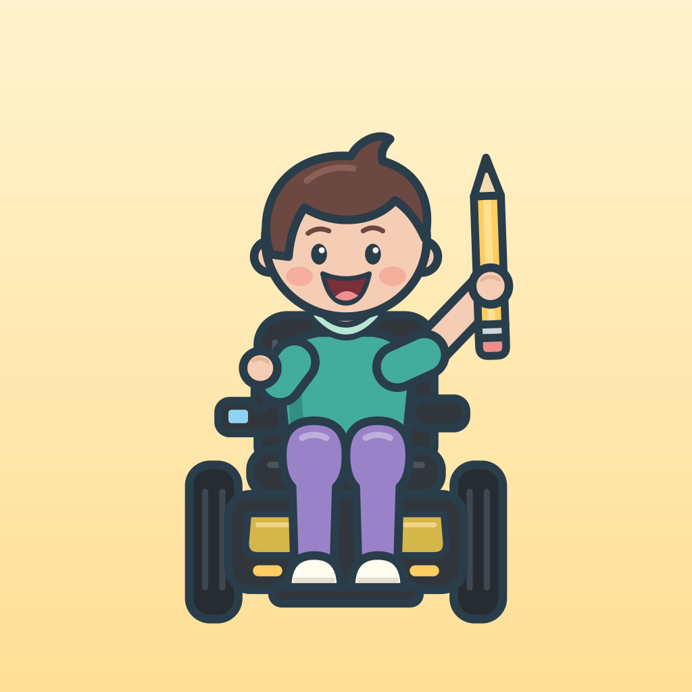

# Color

**Color** est un petit atelier de dessin vectoriel pour les enfants, inspiré de Tux Paint mais écrit entièrement de zéro. Il fonctionne sur Mac, iPhone et iPad. Les versions Linux et Windows sont expérimentales : essayées en émulation, elles semblent bien fonctionner. Sans publicité, sans compte, sans Internet : Color ne collecte aucune donnée ([confidentialité](docs/confidentialite.html)).

Créé par **Alejandro San Martin Lamas** ([github.com/alejandrosml](https://github.com/alejandrosml)). Logiciel libre sous [licence MIT](LICENSE) : chacun peut l’utiliser, le copier, le modifier et le redistribuer, en gardant la mention de son auteur.

## Ce qu’il sait faire

- Le pinceau à cinq pointes (rond, feutre, plume, craie, aérographe), qui suit la pression du stylet ; la ligne ; les formes — rectangle, ovale, triangle, étoile, cœur, losange, hexagone, flèche — et l’aimant, qui redresse une forme dessinée à main levée.
- La magie : un arc-en-ciel, de l’herbe, des briques, des confettis, et un miroir qui dessine deux fois.
- Le pot de peinture, qui remplit aussi le papier entre les traits, d’une couleur ou d’un dégradé ; la gomme, qui coupe les traits là où elle passe.
- Le texte, en cinq écritures ; les tampons ; tourner et retourner ce qu’on a posé.
- Un mélangeur qui mélange les couleurs comme de la peinture ; les couleurs choisies restent d’une fois à l’autre.
- Douze pages à colorier, et jusqu’à huit calques.
- « Mes dessins » et son diaporama, l’impression, et l’export en PNG ou en SVG.
- Le film du dessin, qui se refait tout seul.
- Dessiner par-dessus une image.
- En français et en anglais, selon la langue de l’appareil ou celle des options.

## Pensé pour les enfants

- De grandes cibles, faciles à toucher pour une petite main ; « Régler le toucher », le trait tranquille pour une main qui tremble, un pointeur au clavier ou à la manette.
- Trois niveaux d’interface, dont un niveau « tout-petits » à quatre outils.
- Des options réservées à l’adulte, qu’une petite multiplication peut protéger.
- La prise en charge des lecteurs d’écran et du grand texte.

## Comment il est fait

- L’interface en Dart, avec Flutter : `prototypes/flutter-rust/lib/`.
- Le cœur en Rust — le document vectoriel, son format de fichier, l’historique, les pages à colorier, les tampons, les sons : `prototypes/native-swift-rust/core/`. Ses seules bibliothèques, celles de la lecture SVG et de la compression des dessins, sont recopiées dans `vendor/` : rien n’est téléchargé pour le construire.
- Ce que seul chaque système sait faire : en Swift sur le Mac, l’iPhone et l’iPad (impression, sons, enregistrement) ; en Kotlin sur Android ; en C++ sur Linux et Windows (impression).
- Plus de 1 100 tests Flutter et 289 tests Rust ; certains éprouvent la lecture des projets sur des milliers de fichiers volontairement abîmés, et le lecteur de projets est passé au fuzzing.

## Construire

- Flutter 3.47 et le Rust de Homebrew (1.99).
- Mac : `scripts/macos/construire-color.py`.
- iPhone et iPad : `scripts/macos/essayer-ios.py` installe ce qu’il faut, construit Color et l’essaie dans le simulateur.
- Linux et Windows : versions expérimentales ; leurs scripts de construction ne sont pas encore publiés.
- Les tests : `cargo test` dans le dossier du cœur, `flutter test` dans celui de l’application.

Les sons, les polices et les bibliothèques gardent leurs propres licences : `prototypes/native-swift-rust/core/sons/PROVENANCE.md`, `prototypes/native-swift-rust/core/third-party-notices.txt`, et les fichiers `LICENCE-*.txt` de `prototypes/flutter-rust/fonts/`.
