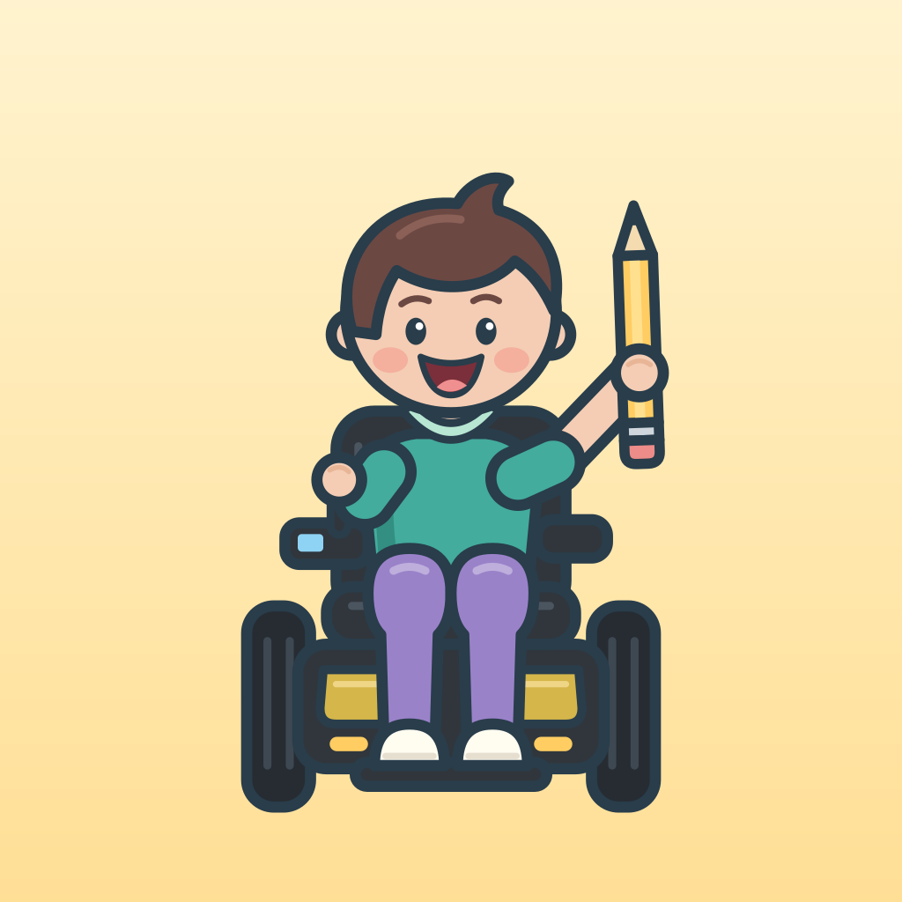

# Color

**Color** est un petit atelier de dessin vectoriel pour les enfants, inspiré de Tux Paint mais écrit entièrement de zéro. Il fonctionne sur Mac, iPhone et iPad. Les versions Linux et Windows sont expérimentales : essayées en émulation, elles semblent bien fonctionner. Sans publicité, sans compte, sans Internet : Color ne collecte aucune donnée ([confidentialité](docs/confidentialite.html)).

Créé par **Alejandro San Martin Lamas** ([github.com/alejandrosml](https://github.com/alejandrosml)). Logiciel libre sous [licence MIT](LICENSE) : chacun peut l’utiliser, le copier, le modifier et le redistribuer, en gardant la mention de son auteur.

## Ce qu’il sait faire

- Le pinceau, la ligne, le rectangle, l’ovale, le texte, les tampons, le pot de peinture et la gomme.
- Douze pages à colorier, et jusqu’à huit calques.
- « Mes dessins », l’impression, et l’export en PNG ou en SVG.
- Le film du dessin, qui se refait tout seul.
- Dessiner par-dessus une image.

## Pensé pour les enfants

- De grandes cibles, faciles à toucher pour une petite main.
- Trois niveaux d’interface, dont un niveau « tout-petits » à quatre outils.
- Des options réservées à l’adulte, qu’une petite multiplication peut protéger.
- La prise en charge des lecteurs d’écran et du grand texte.

## Comment il est fait

- L’interface en Dart, avec Flutter : `prototypes/flutter-rust/lib/`.
- Le cœur en Rust — le document vectoriel, son format de fichier, l’historique, les pages à colorier, les tampons, les sons : `prototypes/native-swift-rust/core/`. Ses seules bibliothèques, celles de la lecture SVG, sont recopiées dans `vendor/` : rien n’est téléchargé pour le construire.
- Ce que seul chaque système sait faire : en Swift sur le Mac, l’iPhone et l’iPad (impression, sons, enregistrement) ; en C++ sur Linux et Windows (impression).
- Près de 800 tests Flutter et 208 tests Rust ; certains éprouvent la lecture des projets sur 42 000 fichiers volontairement abîmés.

## Construire

- Flutter 3.47 et le Rust de Homebrew (1.99).
- Mac : `scripts/macos/construire-color.py`.
- iPhone et iPad : `scripts/macos/essayer-ios.py` installe ce qu’il faut, construit Color et l’essaie dans le simulateur.
- Linux et Windows : versions expérimentales ; leurs scripts de construction ne sont pas encore publiés.
- Les tests : `cargo test` dans le dossier du cœur, `flutter test` dans celui de l’application.

Les sons, la police et les bibliothèques gardent leurs propres licences : `prototypes/native-swift-rust/core/sons/PROVENANCE.md`, `prototypes/native-swift-rust/core/third-party-notices.txt`, `prototypes/flutter-rust/fonts/LICENCE-DejaVu.txt`.
